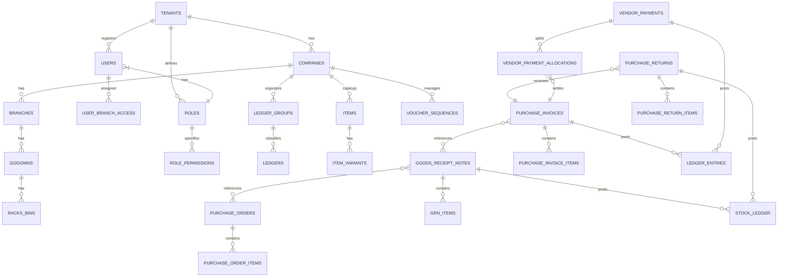

# Zeno Books: Enterprise Architecture Specification

## 1. Executive Summary & System Overview

**Zeno Books** is an enterprise-grade, multi-tenant SaaS Enterprise Resource Planning (ERP) and Accounting platform engineered for small and medium-sized businesses. It provides end-to-end operational automation across **Accounting, Inventory Management, Sales, Purchase (Procure-to-Pay), and Light Manufacturing (BOM-based assembly)**.

### Core Architectural Pillars
- **Strict Multi-Tenancy:** Shared database model with explicit `tenant_id` partitioning on all business tables, enforced through PostgreSQL Row Level Security (RLS) policies and NestJS Tenant Execution Context guards.
- **Enterprise Hierarchy:** `Tenant` > `Company` > `Branch` > `Godown` > `Rack/Bin`.
- **True Double-Entry Ledger Engine:** Zero floating balances. Every monetary movement generates strictly balanced Debit (`Dr`) and Credit (`Cr`) lines in an immutable transaction ledger.
- **Transactional Stock Ledger:** Inventory is tracked in real-time with an append-only stock ledger recording Item, Variant, Godown, Rack/Bin, Quantity In/Out, and Valuation Rate.
- **Concurrency & Gap-Safe Sequencing:** Voucher numbers are generated with pessimistic row-locking (`SELECT ... FOR UPDATE`) per financial year and branch, preventing sequence gaps and duplicate collisions.
- **Indian GST Compliance:** Native support for intra-state (CGST + SGST), inter-state (IGST), Cess, Place of Supply resolution, HSN/SAC codes, and flexible GST configuration levels (Company, Group, Category, or Item).
- **Extensible Feature Toggles:** Tenant-level switches for GST, Purchase Orders, Goods Receipt Notes (GRN), Item Variants, Rack/Bin locations, and Manufacturing. Inactive features are fully hidden across both API endpoints and the UI.

---

## 2. Global Repository & Folder Architecture

A modular monorepo structure separates the NestJS REST API backend (`zeno-api`) from the Angular frontend (`zeno-web`), sharing contracts and domain types.

```text
zeno-books/
├── docs/
│   ├── architecture.md
│   └── er-diagram.png
├── docker-compose.yml
├── .env.example
├── README.md
├── zeno-api/                      # NestJS Backend API
│   ├── src/
│   │   ├── main.ts                # App bootstrap, Helmet, CORS, ValidationPipe, Swagger
│   │   ├── app.module.ts          # Root module orchestrating domain modules
│   │   ├── common/                # Shared kernel
│   │   │   ├── decorators/        # @CurrentUser(), @CurrentTenant(), @RequirePermissions()
│   │   │   ├── guards/            # JwtAuthGuard, TenantGuard, PermissionsGuard
│   │   │   ├── interceptors/      # AuditLogInterceptor, TransformResponseInterceptor
│   │   │   ├── filters/           # GlobalExceptionFilter, PostgresErrorFilter
│   │   │   ├── middleware/        # TenantContextMiddleware (AsyncLocalStorage + DB RLS setter)
│   │   │   ├── database/          # TypeORM/Prisma DataSource, Migration runner, BaseEntity
│   │   │   └── utils/             # Money math, GST calculator, Voucher generator
│   │   ├── modules/
│   │   │   ├── auth/              # Signup, Email OTP, Login, Refresh Token, Forgot Password
│   │   │   ├── tenancy/           # Tenant provisioning, Company, Branch, Godown, RackBin
│   │   │   ├── rbac/              # Roles, Permissions, User Branch Access
│   │   │   ├── settings/          # Feature Toggles, GST Level, Default Ledger Mappings
│   │   │   ├── masters/
│   │   │   │   ├── ledger-groups/ # Predefined Tally groups + custom parent/child
│   │   │   │   ├── ledgers/       # Predefined & custom ledgers (Cash, Bank, Tax, Vendors)
│   │   │   │   ├── units/         # Measurement units with precision decimals (Nos=0, Kg=3)
│   │   │   │   ├── item-groups/   # Group-level GST and classification
│   │   │   │   ├── item-categories/# Linked sub-categories
│   │   │   │   ├── items/         # Basic, Sales/Purchase, Image, Description tabs
│   │   │   │   └── variants/      # Attribute-based item variants (Color, Size)
│   │   │   ├── procure-to-pay/    # Phase 1 Primary Focus
│   │   │   │   ├── purchase-orders/     # PO header, lines, approval, pending balance
│   │   │   │   ├── goods-receipt-notes/ # GRN header, lines, PO auto-pull, Stock-IN
│   │   │   │   ├── purchase-invoices/   # PI header, GRN lines loading, Tax posting
│   │   │   │   ├── purchase-returns/    # Debit note / return with stock & tax reversal
│   │   │   │   └── vendor-payments/     # Multi-bill allocation, Cash/Bank, Discount
│   │   │   ├── accounting/        # Double-entry ledger engine, voucher sequences, journal
│   │   │   ├── inventory/         # Stock ledger engine, valuation, stock summary
│   │   │   ├── audit/             # Immutable audit trail logger
│   │   │   └── reports/           # Procure-to-pay reports, ledgers, tax summaries
│   │   └── database/
│   │       ├── migrations/        # Versioned PostgreSQL schema migrations
│   │       └── seeds/             # Standard Tally groups, default ledgers, superadmin
│   ├── test/                      # E2E test suites (P2P flow, concurrency tests)
│   ├── tsconfig.json
│   ├── package.json
│   └── Dockerfile
│
└── zeno-web/                      # Angular Frontend (Standalone Components + Signals)
    ├── src/
    │   ├── main.ts
    │   ├── index.html
    │   ├── styles.scss            # Premium design tokens, CSS variables, dark/light themes
    │   ├── app/
    │   │   ├── app.config.ts      # Providers, HTTP Interceptors, Route config
    │   │   ├── app.routes.ts      # Lazy-loaded feature routes with RBAC guards
    │   │   ├── core/
    │   │   │   ├── auth/          # AuthService, TokenStorage, AuthGuard
    │   │   │   ├── interceptors/  # AuthInterceptor, ErrorInterceptor, TenantHeaderInterceptor
    │   │   │   ├── services/      # ApiService, NotificationService, ExportService
    │   │   │   └── state/         # TenantContextStore, FeatureToggleStore, UserSessionStore
    │   │   ├── shared/
    │   │   │   ├── components/    # DataTable, PageHeader, Modal, LineItemEditor, StatusBadge
    │   │   │   ├── directives/    # HasPermissionDirective, FeatureFlagDirective, KeyboardNav
    │   │   │   └── pipes/         # CurrencyFormatPipe, DateFormatPipe, HsnCodePipe
    │   │   └── features/
    │   │       ├── auth/          # Login, Register, VerifyOtp, ForgotPassword
    │   │       ├── dashboard/     # P2P metrics, pending orders, recent vouchers
    │   │       ├── settings/      # Company profile, Feature toggles, Tax, Ledgers
    │   │       ├── masters/       # Ledgers, LedgerGroups, Items, Units, Godowns
    │   │       ├── procure-to-pay/# PO, GRN, Purchase Invoice, Purchase Return, Payments
    │   │       └── coming-soon/   # Placeholders for Sales, BOM/Mfg, Cheques, etc.
    ├── angular.json
    ├── package.json
    └── Dockerfile
```

---

## 3. Comprehensive Database Schema & Entity Relationships

The schema is built around relational referential integrity, tenant isolation, and strict auditability.



---

## 4. Multi-Tenant Isolation & PostgreSQL Row Level Security (RLS)

Every transactional and master table includes `tenant_id UUID NOT NULL REFERENCES tenants(id)`.
PostgreSQL RLS is enabled:
```sql
ALTER TABLE ledgers ENABLE ROW LEVEL SECURITY;
ALTER TABLE ledgers FORCE ROW LEVEL SECURITY;

CREATE POLICY tenant_isolation_policy ON ledgers
AS RESTRICTIVE
USING (tenant_id = NULLIF(current_setting('app.current_tenant_id', true), '')::UUID)
WITH CHECK (tenant_id = NULLIF(current_setting('app.current_tenant_id', true), '')::UUID);
```

### NestJS Tenant Context Interception
1. HTTP requests pass through `TenantContextMiddleware`.
2. Middleware extracts `tenant_id` from the verified JWT payload or explicit `X-Tenant-Id` header (validated against user's permitted tenant).
3. The context is held in Node.js `AsyncLocalStorage`.
4. The database connection/transaction runner sets the session variable immediately before executing any statement:
   ```typescript
   await queryRunner.query(`SET LOCAL app.current_tenant_id = '${tenantId}';`);
   ```

---

## 5. Role-Based Access Control (RBAC) & Permission Model

Permissions are structured hierarchically: `Scope:Resource:Action`
- **Scopes:**
  - `Master`: Ledger, LedgerGroup, Item, Unit, ItemGroup, Godown, RackBin
  - `Transaction`: PurchaseOrder, GoodsReceiptNote, PurchaseInvoice, PurchaseReturn, VendorPayment, SalesInvoice, JournalEntry
  - `Report`: LedgerReport, TrialBalance, ProfitAndLoss, StockSummary, GstReport, OutstandingPayables
- **Actions:** `VIEW`, `CREATE`, `EDIT`, `DELETE`, `PRINT`, `EXPORT`

Users are granted access to specific branches (`user_branch_access`). When creating or querying transactions, the API automatically enforces that `branch_id` belongs to the user's branch authorization set.

---

## 6. Gap-Safe Concurrency-Safe Voucher Numbering Engine

- Table `voucher_sequences` with a unique index on `(tenant_id, company_id, branch_id, voucher_type, financial_year)`.
- Inside the transaction:
  ```sql
  SELECT current_number, prefix, suffix, padding_digits
  FROM voucher_sequences
  WHERE tenant_id = :tenantId
    AND company_id = :companyId
    AND branch_id = :branchId
    AND voucher_type = :voucherType
    AND financial_year = :fy
  FOR UPDATE;
  ```
- Formatted voucher: `${prefix}${String(nextNumber).padStart(padding_digits, '0')}${suffix}` (e.g., `PO/2025-26/0042`).

---

## 7. Accounting Posting Rules & Stock Ledger Mechanics

- **PO:** Intent only, no stock or accounting impact.
- **GRN:** Posts **STOCK IN** to `stock_ledger` for received items.
- **Purchase Invoice:** Posts balanced double-entry:
  - `Dr` Purchase Account / Inventory
  - `Dr` Input CGST / SGST / IGST
  - `Dr`/`Cr` Round Off
  - `Cr` Vendor Ledger
  - Direct Purchase (when GRN disabled) also posts **STOCK IN**.
- **Purchase Return:** Reverses invoice accounting lines and posts **STOCK OUT**.
- **Vendor Payment:**
  - `Dr` Vendor Ledger
  - `Cr` Cash / Bank Ledger
  - `Cr` Discount Received
  - Allocates payment against specific pending purchase invoices to track clear/partial status.
